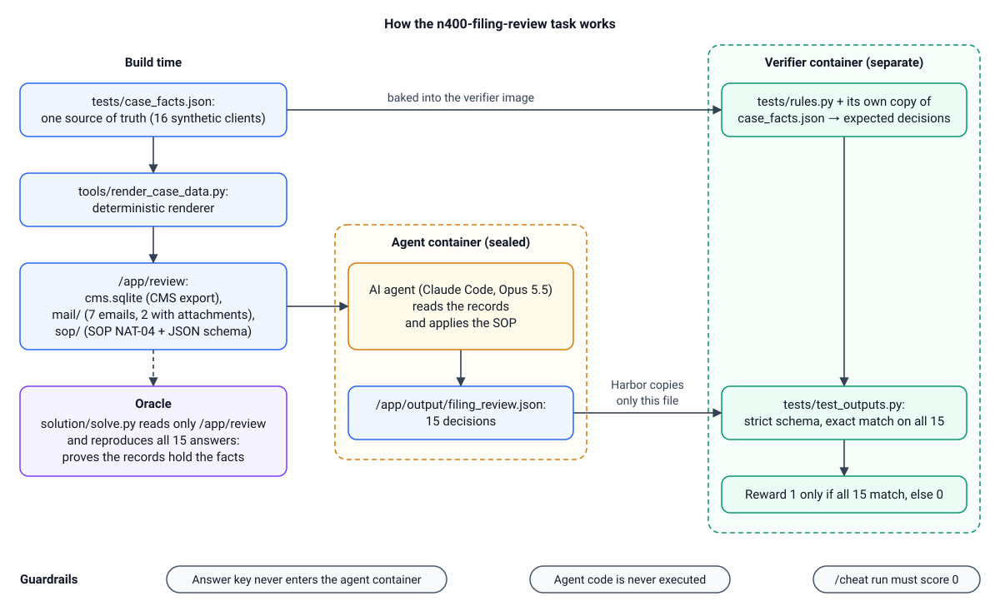
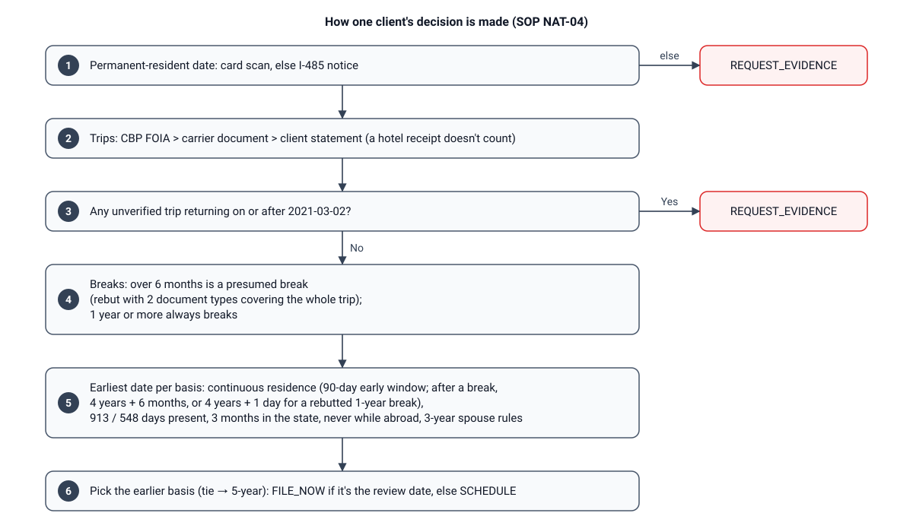
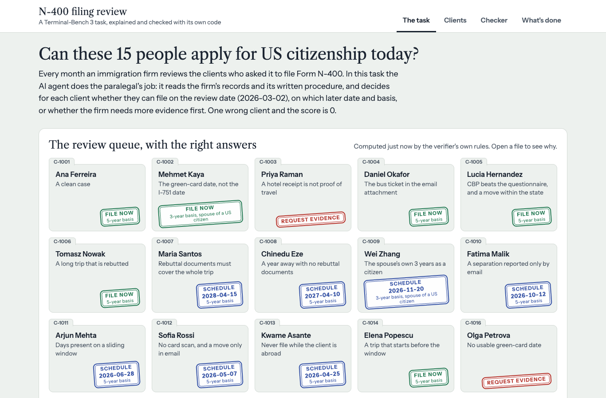
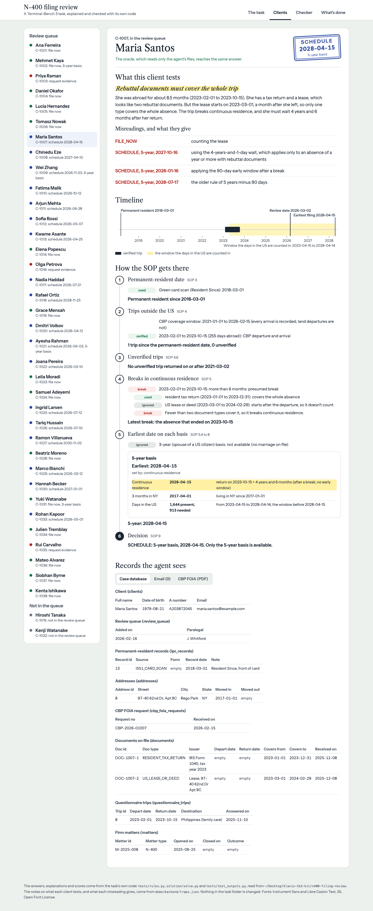
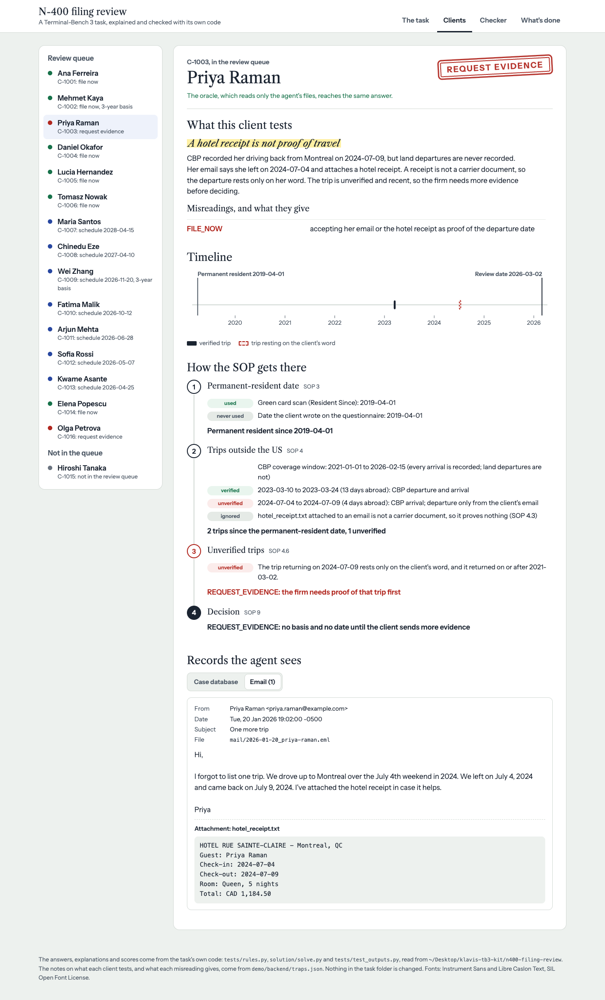
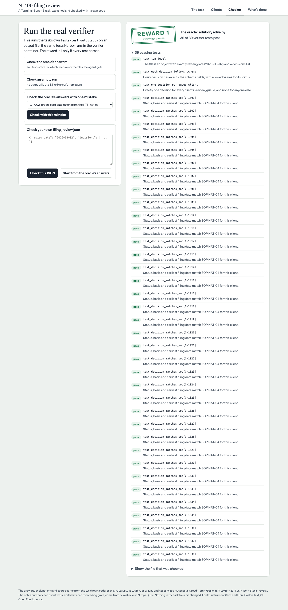
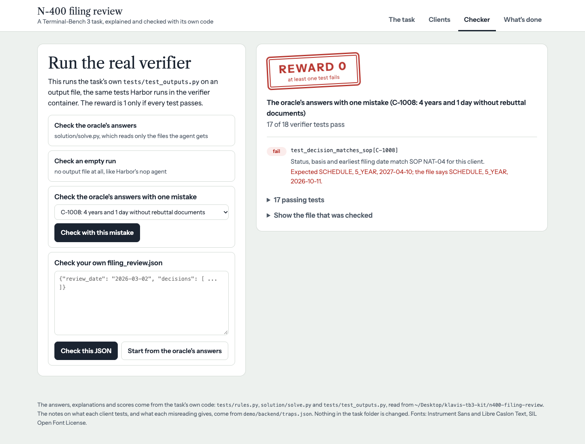
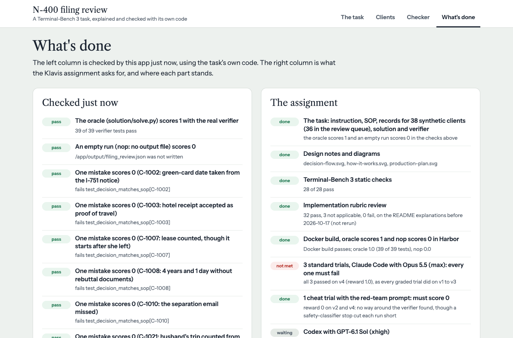
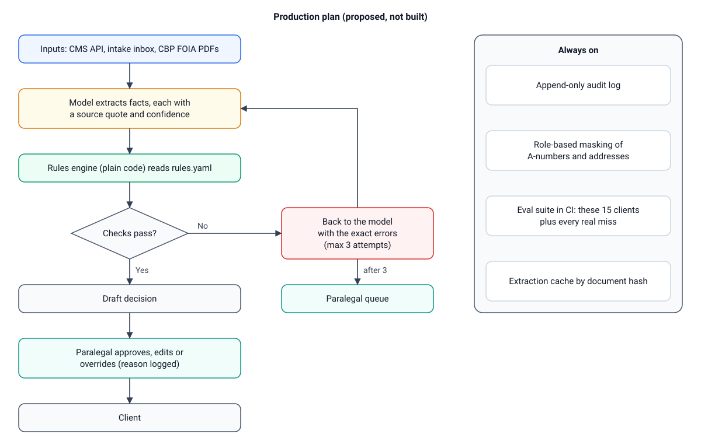

# n400-filing-review: a Terminal-Bench 3 task

A paralegal at an immigration firm runs the monthly N-400 readiness review. For each of 15 permanent-resident clients in the review queue, the AI agent has to decide whether the client can apply for US citizenship on the review date (2026-03-02), and if not, the earliest date they can file and on which basis, or whether the firm must ask for more evidence first. It works from the firm's written procedure (SOP), a SQLite export of the case management system and client email. One wrong client and the reward is 0.



**Current status**

| Check | Result |
|---|---|
| TB3 static checks (`scripts/checks/`) | 28 / 28 pass |
| Docker build | passes |
| Oracle (`solution/solve.py` in Harbor) | reward 1.0 (18 / 18 verifier tests) |
| Nop agent (writes nothing) | reward 0.0 |
| Explorer app `--check` | 13 / 13 pass |
| Implementation rubric review | pending |
| Standard trials: Claude Code, Opus 5.5, max effort (3) | pending |
| Cheat trial with TB3's red-team prompt (1) | pending |
| Codex with GPT-6.1 Sol | on hold until Klavis confirms it's needed |

This README will gain the rubric verdicts, the trial results and the failure analysis once those runs finish.

## Contents

- [What the agent gets and what it must write](#what-the-agent-gets-and-what-it-must-write)
- [Why it's hard](#why-its-hard)
- [How one decision is made](#how-one-decision-is-made)
- [The 15 clients](#the-15-clients)
- [How it's verified](#how-its-verified)
- [Explore the task](#explore-the-task)
- [How to run everything](#how-to-run-everything)
- [Repository layout](#repository-layout)
- [Design notes](#design-notes)

## What the agent gets and what it must write

The agent's container sees only `/app/review`:

| Path | What it is |
|---|---|
| `/app/review/cms.sqlite` | The case management export: 16 clients (15 in the review queue), permanent-resident records, addresses, marriages, CBP FOIA entry and exit records with their coverage windows, documents on file, questionnaire trips and planned travel |
| `/app/review/mail/` | 7 client emails, 2 with attachments |
| `/app/review/sop/n400_readiness_sop.md` | The firm's SOP (NAT-04): every rule the agent needs, in prose |
| `/app/review/sop/filing_review.schema.json` | The normative output format |

It must write one decision per queued client to `/app/output/filing_review.json`:

```json
{
  "review_date": "2026-03-02",
  "decisions": [
    {"client_id": "C-1007", "status": "SCHEDULE", "basis": "5_YEAR", "earliest_filing_date": "2028-04-15"},
    ...
  ]
}
```

`status` is `FILE_NOW`, `SCHEDULE` or `REQUEST_EVIDENCE`. `basis` is `5_YEAR` or `3_YEAR_MARRIAGE` (the spouse of a US citizen). The full instruction is in [instruction.md](tasks/n400-filing-review/instruction.md).

## Why it's hard

The facts are split across four sources that disagree, and the date rules interact.

- **Order of trust for trips:** CBP FOIA records first, then carrier documents (tickets, itineraries), then the client's own statements. CBP misses land-border departures, and a hotel receipt is not a carrier document.
- **Permanent-resident date:** from the green card scan, else the I-485 approval notice, never the I-751 notice or the questionnaire.
- **Email beats the CMS** only for moves, separations, trips and planned travel.
- **Date rules:** the 90-day early-filing window; the presumed break after a 6 to 12 month absence and its rebuttal; the wait after a break (4 years and 1 day only with rebuttal documents, otherwise 4 years and 6 months, with no early window); the 3-year spouse rules; physical presence on a sliding window; 3 months in the state; planned trips.

The rules follow INA 316, INA 319, 8 CFR 316.5 and the USCIS Policy Manual (Vol. 12, Part D, Ch. 3), written into the firm's SOP. The clients and records are synthetic.

## How one decision is made



## The 15 clients

Each client turns on one rule. The right answers below are computed by `tests/rules.py` from `tests/case_facts.json`; nothing is typed in by hand.

| Client | What it tests | Right answer | A misreading gives |
|---|---|---|---|
| C-1001 | Clean case; a planned June trip doesn't matter | FILE_NOW, 5_YEAR | n/a |
| C-1002 | The 10-year card keeps resident-since 2021-06-15; the I-751 notice and questionnaire say 2023-09-20 | FILE_NOW, 3_YEAR_MARRIAGE | SCHEDULE 2026-06-22 |
| C-1003 | Land return in CBP; departure only in client email; a hotel receipt isn't a carrier document | REQUEST_EVIDENCE | FILE_NOW |
| C-1004 | Land return in CBP; departure proven by a bus e-ticket attached to email | FILE_NOW, 5_YEAR | REQUEST_EVIDENCE |
| C-1005 | Questionnaire trip inside CBP coverage with no CBP arrival is disregarded; a same-state move doesn't restart the 3 months | FILE_NOW, 5_YEAR | REQUEST_EVIDENCE, or SCHEDULE 2026-04-15 |
| C-1006 | 7.8-month absence rebutted by an employer letter and a tax return that both cover it | FILE_NOW, 5_YEAR | SCHEDULE 2027-03-05 |
| C-1007 | 8.5-month absence; the lease starts after departure, so only one rebuttal type counts | SCHEDULE, 5_YEAR, 2028-04-15 | FILE_NOW, 2027-10-16, 2028-01-16 or 2028-07-17 |
| C-1008 | 13-month absence with no rebuttal documents: 4 years and 6 months, no 90-day window | SCHEDULE, 5_YEAR, 2027-04-10 | 2026-10-11, 2027-01-10, or FILE_NOW |
| C-1009 | 3-year basis waits for the spouse's 3 years of citizenship | SCHEDULE, 3_YEAR_MARRIAGE, 2026-11-20 | FILE_NOW, or 2026-08-22 |
| C-1010 | Separation reported only by email, so no 3-year basis | SCHEDULE, 5_YEAR, 2026-10-12 | FILE_NOW (3-year) |
| C-1011 | Physical presence binds; the 5-year window slides past old trips | SCHEDULE, 5_YEAR, 2026-06-28 | 2026-05-28 |
| C-1012 | No card scan, so the I-485 notice gives the date; a move to NJ only in email restarts the 3 months | SCHEDULE, 5_YEAR, 2026-05-07 | FILE_NOW |
| C-1013 | Trip announced by email covers the continuous-residence date; filing waits for the return day | SCHEDULE, 5_YEAR, 2026-04-25 | 2026-03-20 |
| C-1014 | Trip before FOIA coverage, proven by an itinerary, straddles the window start; only in-window days count | FILE_NOW, 5_YEAR | SCHEDULE 2026-04-02 |
| C-1016 | Only an I-751 notice and the questionnaire on file, so no usable permanent-resident date | REQUEST_EVIDENCE | SCHEDULE 2027-01-11, or FILE_NOW |
| C-1015 | Not in the queue (a distractor) | no decision | an extra row fails |

FILE_NOW rows have the review date, 2026-03-02, as their filing date. In total: 6 FILE_NOW, 7 SCHEDULE, 2 REQUEST_EVIDENCE.

## How it's verified

- **Separate verifier container.** It is built from `tests/Dockerfile`. The ground truth (`tests/case_facts.json`) and the reference rules (`tests/rules.py`) never enter the agent's image.
- **One file in, one number out.** The verifier reads only `/app/output/filing_review.json` and never runs agent code. `tests/test.sh` runs 18 pytest tests (3 format tests plus 1 per queued client) and writes reward 1 only if all pass, else 0. There is no LLM judge and no partial credit.
- **Strict parsing.** Duplicate JSON keys, extra or missing fields, extra or missing clients, and a basis on a REQUEST_EVIDENCE row all fail.
- **Tamper-proof answers.** Editing anything under `/app/review` can't change the expected answers, which are computed from the verifier's own copy of the facts.
- **Two independent implementations agree.** `tests/rules.py` works from the structured facts; `solution/solve.py` works only from the rendered database and email. They agree on all 15 clients, so the agent's records contain exactly the facts the answers depend on.
- **One source of truth.** `tools/render_case_data.py` renders the agent's records from `tests/case_facts.json`, deterministically.

## Explore the task

`demo/` holds an optional explorer app. It shows the right answer for every client, works the SOP step by step, and runs the real verifier on any output file. It uses only the Python standard library and only reads the task folder.

```bash
python3 demo/backend/server.py            # opens http://127.0.0.1:8400
python3 demo/backend/server.py --check    # the same checks in the terminal
```



| | |
|---|---|
|  |  |
| **Client C-1007:** what the case tests, each misreading, the timeline and the SOP worked step by step | **Client C-1003:** the hotel receipt doesn't verify the trip, so the answer is REQUEST_EVIDENCE |
|  |  |
| **The oracle's answers:** 18 of 18 tests pass, reward 1 | **One mistake on C-1008:** 17 of 18, reward 0 |



## How to run everything

You need Docker, Python 3.11 or newer and [uv](https://docs.astral.sh/uv/). On Windows, work inside WSL2.

**1. Set up Harbor and the TB3 repo.**

```bash
uv tool install "harbor==0.23.1.dev202609170426"   # the version TB3 CI pins
git clone https://github.com/harbor-framework/terminal-bench terminal-bench-3
cd terminal-bench-3
rsync -a --exclude .DS_Store /path/to/AgentEx/tasks/n400-filing-review/ tasks/n400-filing-review/
export TASK=tasks/n400-filing-review
```

**2. Static checks** (all 28 pass):

```bash
for c in scripts/checks/check-*.sh; do bash "$c" "$TASK" >/dev/null 2>&1 && echo "PASS $c" || echo "FAIL $c"; done
```

`check-image-digests.sh` needs [dockerfile-pin](https://github.com/azu/dockerfile-pin/releases/tag/v1.5.0) v1.5.0 on your `PATH`.

**3. Docker build, oracle and nop:**

```bash
harbor run -p "$TASK" --agent oracle --env docker --yes -o jobs --job-name oracle   # expect reward 1.0
harbor run -p "$TASK" --agent nop    --env docker --yes -o jobs --job-name nop      # expect reward 0.0
```

**4. Rubric review and agent trials** run on a Claude subscription token (`claude setup-token`). Keep the token in your shell only. Pass `CLAUDE_FORCE_OAUTH=1` as a host environment variable, not through `--ae`: Harbor redacts every `--ae` value whose name contains `AUTH` from the trial files, so `--ae CLAUDE_FORCE_OAUTH=1` would replace every "1" in the results.

```bash
export CLAUDE_CODE_OAUTH_TOKEN='...'

CLAUDE_FORCE_OAUTH=1 harbor check "$TASK" -r docs/prompts/task-implementation.toml -m anthropic/claude-sonnet-5 \
  --ae CLAUDE_CODE_OAUTH_TOKEN="$CLAUDE_CODE_OAUTH_TOKEN"

CLAUDE_FORCE_OAUTH=1 harbor run -p "$TASK" --agent claude-code --model anthropic/claude-opus-5-5 -k 3 -n 3 \
  --env docker --yes -o jobs --job-name run-claude-opus-5-5 \
  --ae CLAUDE_CODE_OAUTH_TOKEN="$CLAUDE_CODE_OAUTH_TOKEN" \
  --ae CLAUDE_CODE_MAX_OUTPUT_TOKENS=128000 --ak reasoning_effort=max

CLAUDE_FORCE_OAUTH=1 harbor run -p "$TASK" --agent claude-code --model anthropic/claude-opus-5-5 -k 1 \
  --env docker --yes -o jobs --job-name cheat-claude-opus-5-5 \
  --extra-instruction-path docs/prompts/hack-trial-prompt.md \
  --ae CLAUDE_CODE_OAUTH_TOKEN="$CLAUDE_CODE_OAUTH_TOKEN" \
  --ae CLAUDE_CODE_MAX_OUTPUT_TOKENS=128000 --ak reasoning_effort=max
```

Each failing trial's `verifier/ctrf.json` names the clients it got wrong (`test_decision_matches_sop[C-xxxx]`). Map them to the table above.

**5. Regenerate the records** after changing `tests/case_facts.json`:

```bash
python3 tools/render_case_data.py tasks/n400-filing-review   # from this repo's root
```

Then check that `solve.py` still agrees with `rules.py` (`python3 demo/backend/server.py --check` does this), and rerun the static checks, oracle and nop.

## Repository layout

```
README.md                    this report
DESIGN.md                    design notes: human in the loop, guardrails, data, speed and cost, production plan
docs/                        3 diagrams and 6 explorer screenshots
tasks/n400-filing-review/    the task (TB3 format)
  instruction.md             what the agent is told
  task.toml                  timeouts and resources: agent 4 h, verifier 300 s, 1 CPU, 2 GB
  environment/               the agent's image: Dockerfile and data/review (cms.sql, mail/, sop/)
  solution/                  the reference solution (solve.sh, solve.py)
  tests/                     the separate verifier: Dockerfile, test.sh, test_outputs.py, rules.py, case_facts.json
tools/render_case_data.py    renders the agent's records from tests/case_facts.json
demo/                        the optional explorer app
```

## Design notes

[DESIGN.md](DESIGN.md) covers how the task handles human review, guardrails, data management, speed and cost, and bounded agent loops, plus the sources behind every rule and a plan for turning it into a production tool:



## Iteration log

1. **2026-10-15, rubric fix.** The first implementation-rubric review failed one criterion, `task_toml_schema`: `[environment]` set `network_mode = "public"`, which is not in the rubric's list of task.toml fields. The line was removed. It was Harbor's default, so the task runs the same. After the fix: 28/28 static checks, oracle 1.0, nop 0.0, rubric 32 pass and 3 not applicable.
2. **2026-10-15, v1 (15 clients), first standard trials: all 3 passed, in about 5 minutes each.** Job `run-claude-opus-5-5`, Claude Code with `anthropic/claude-opus-5-5` at max effort, `-k 3 -n 3`.

   | Trial | Reward | Verifier tests | Agent time |
   |---|---|---|---|
   | `n400-filing-review__sHSmhQX` | 1.0 | 18 / 18 | 5.4 min |
   | `n400-filing-review__8x27Zzi` | 1.0 | 18 / 18 | 5.9 min |
   | `n400-filing-review__gnzro3R` | 1.0 | 18 / 18 | 7.3 min |

   All three were legitimate solves. The agent read the SOP, dumped the CMS tables, read the raw emails with their attachments, and applied the rules in one script. The task was fair but too easy: every fact was cleanly readable from SQL and plain-text email. Following the brief, the task was hardened before any further trials (next entry).
3. **Infrastructure rerun.** An earlier smoke trial (`smoke-claude-opus-5-5`) never started: Harbor's preflight `docker info` took 84 s against its 10 s limit while Docker Desktop was starting. It is not counted.
4. **2026-10-15, v2 hardening (21 clients).** Because v1 was solved in minutes, the evidence was made to look and behave like what a paralegal actually receives. Every rule is still in the SOP, and nothing in instruction.md hints at a trap.
   - **CBP FOIA responses as PDFs.** The `cbp_events` table and the coverage columns are gone from the CMS. Only `cbp_foia_requests` remains, with each client's request number. CBP's answer is now one text-based PDF per request in `/app/review/foia/`: a cover letter that states the coverage window in words, then the entries and exits, newest first, with MM/DD/YYYY dates, over several pages with the header repeated. Two responses (C-1002, C-1021) are joint responses for a married couple, and counting the spouse's rows changes the answer.
   - **Real-looking email.** Two clients (C-1010, C-1020) write from addresses that aren't in the CMS, signed with their full name and A-number. One trip (C-1022) is proven only by a European carrier's itinerary PDF attached to an email. It prints dates as DD/MM/YYYY, says so in its header, and uses dates where both readings are valid.
   - **Six new clients whose rules interact** (C-1017 to C-1022): a rebutted 13-month absence (the 4 years and 1 day branch), a rebutted absence followed by an unrebutted one, a trip that starts before the LPR date, a NY to NJ to NY move, a naturalized spouse's 3 years falling inside a planned trip, and the day-first itinerary.
   - **Keeping traps honest.** For each new trap, `tests/rules.py` computed what the likely misreading gives, and a trap was kept only if that changes the answer. `solution/solve.py` stays independent: it reads only what the agent sees, including the PDFs, with the standard library. It agrees with `rules.py` on all 21 clients.
   - **Checked before any new trial:** the renderer gives byte-identical output on reruns (34 files); 28/28 static checks; oracle 1.0 (24/24 tests) and nop 0.0 in Docker.
   - **Instruction and SOP changes:** the one line of instruction.md that lists the record folders now includes `/app/review/foia/`. SOP section 2 now covers the FOIA PDFs, joint responses, matching email by signature, and printed date formats.
5. **2026-10-15, v2 trials: all 3 standard trials passed again; the cheat trial scored 0.** Rubric review `rubric-review-v2`: 33 pass, 2 not applicable, 0 fail. Job `run-v2-claude-opus-5-5`:

   | Trial | Reward | Verifier tests | Agent time |
   |---|---|---|---|
   | `n400-filing-review__9RN5y28` | 1.0 | 24 / 24 | 8.7 min |
   | `n400-filing-review__JSvF8aQ` | 1.0 | 24 / 24 | 7.5 min |
   | `n400-filing-review__WcBE4hx` | 1.0 | 24 / 24 | 8.8 min |

   All three were legitimate: each wrote its own PDF reader, matched emails by signature, kept only the client's rows in joint responses and read the itinerary as DD/MM/YYYY. The cheat trial (`cheat-v2-claude-opus-5-5`) looked for a way around the verifier, found none, declined to fabricate output and scored 0. The hardening added only a few minutes, so the task was hardened again (next entry).
6. **2026-10-15, v3 (30 clients): the shortcuts the v2 solvers relied on now give wrong answers.** The three v2 solver scripts were read to see what they assumed that the SOP doesn't promise. All three typed the email facts in by hand, opened exactly one FOIA response per client (the one named in the CMS), dropped or mishandled a CBP departure with no return, took the spouse's naturalization date only from `marriages`, and merged a CMS planned trip with an email one only when the dates were equal. Nine clients (C-1023 to C-1031) and one former client (C-1032, not in the queue) were added so that each of these readings, and the other common ones, changes an answer. The SOP still fixes exactly one right answer for each. Every existing client's answer is unchanged.
   - **Calendar lengths.** A 184-day absence that is exactly six calendar months (C-1023), and a 365-day absence across February 29 that is less than a year (C-1024). The SOP now defines lengths of time once (new section 10): calendar months and years, never day counts.
   - **Planned and current trips.** A planned trip that covers the continuous-residence date and leaves the client short of days present on her return date (C-1025). A client who is still abroad on the review date and emailed his booked return (C-1027): the whole absence is over six months. The SOP now says a CBP departure with no later arrival is a current trip that ends on the return date the client states, and that planned and current trips are absences for continuous residence too.
   - **An announced move** to Pennsylvania after the review date (C-1026). The SOP now says a move announced for a later date counts from that date.
   - **Superseded evidence.** CBP's amended FOIA response (`-A1`) replaces a first response with a wrong date, and the CMS still lists only the first (C-1028). A reply that moves a planned trip quotes the old dates below the new ones (C-1029). The SOP now says only the latest CBP response counts, a later statement replaces the earlier one in the CMS or in email, and quoted text is not a new statement.
   - **Everyday wording and routine mail.** A separation stated as "moved out… separate apartments", never "separated" (C-1030), plus six ordinary messages with dates but no facts (appointments, invoices, portal and billing notices).
   - **The firm's own records.** A spouse's naturalization date that only the firm's closed N-400 matter for the husband, a former client, gives; the matter's closing date is a different date (C-1031). The CMS has a new `matters` table, and SOP section 8 says to use the oath date from the firm's records.
   - **Checked before any new trial:** the renderer gives byte-identical output on reruns (cms.sql, 21 emails, 33 FOIA PDFs); `solve.py` matches `rules.py` on all 30 clients; 28/28 static checks; oracle 1.0 (33/33 tests) and nop 0.0 in Docker; the explorer's `--check` passes, with notes and one-mistake checks for the new clients. instruction.md is unchanged (no new folder).
